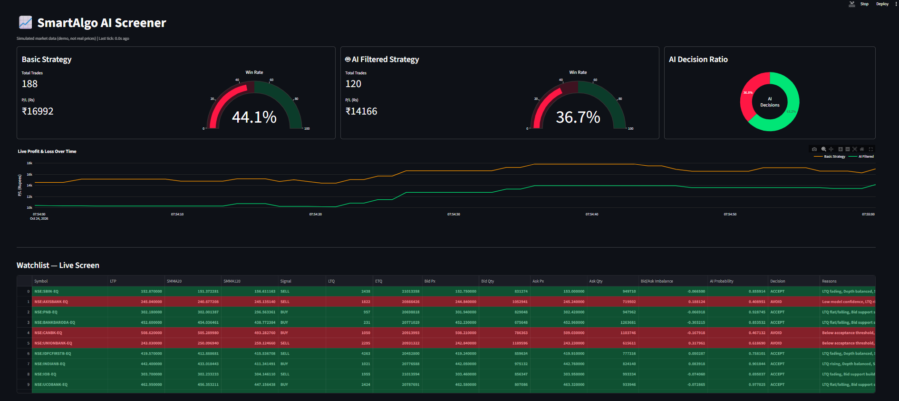
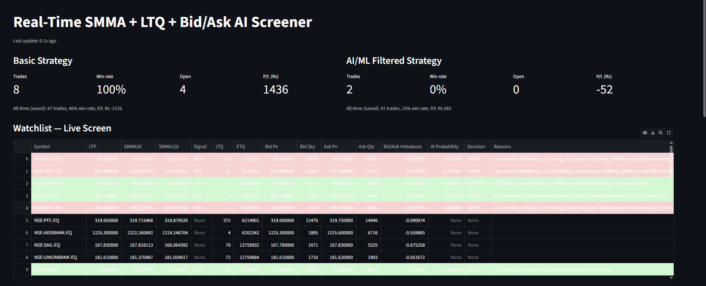
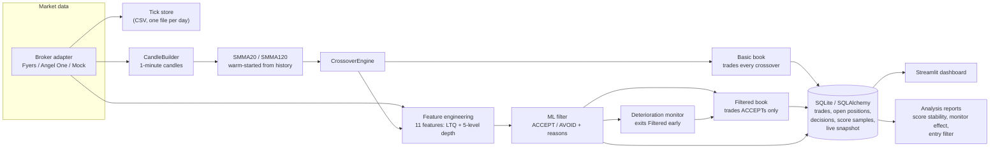

# AI/ML Real-Time Stock Screener (NSE)


**▶ Live demo: https://ai-stock-screener-demo-hwmhgdfx33svxcf78zrsjx.streamlit.app/**

A Python real-time screening and paper-trading system for NSE equities. It detects SMMA20/SMMA120 crossovers, reads Last Traded Quantity (LTQ) dynamics and 5-level Bid/Ask market depth, and passes each signal through a machine-learned **ACCEPT / AVOID** filter. The goal is to catch good trades and, more importantly, to avoid losing ones.



> **Paper trading only.** No real orders are ever placed. Nothing here is investment advice.

## Demo vs. real

The hosted demo runs the **same engine** as the live system (crossover detection, feature engineering, ML filter, paper-trading books) on a **synthetic price feed**, so it works instantly with no broker credentials.

- Prices in the demo are a random walk, so no model can have a real edge there. The demo shows the pipeline mechanics, not trading performance.
- The model was trained on 78 labelled crossovers from six early live Fyers files (some of which overlap, so some crossovers are probably counted twice). On a 16-example validation set it reached an AUC of 0.58, which is statistically indistinguishable from chance (p ≈ 0.33; 95% interval roughly 0.27 to 0.90). Treat it as a demonstration of the pipeline, not a trading edge. It will be retrained on cleaned, de-duplicated data as sessions accumulate.

## Live dashboard



*A live Fyers session on 26 Oct 2026, captured mid-session and before the 15:15 change described in finding 6 below. The "All time (saved)" lines under the tiles count trades that were stopped out or marked at frozen or auction-period prices after 15:15, so they overstate the Basic book's losses (at the time: Basic 87 trades, 46% win rate, −₹2,126; Filtered 41 trades, 15% win rate, +₹583). The tiles count trades closed that day. Row colours show each symbol's latest ACCEPT/AVOID decision, carried forward until its next crossover. The current dashboard adds win-rate gauges, a profit and loss curve, a verdict chart, a watchlist filter and CSV export of closed trades and decisions.*

## Architecture



The paper-trading engine is callback-based and does not depend on the database. A failing database write is logged and never stops the tick loop.

## How it works

1. **Ingest:** live ticks from Fyers (WebSocket + REST historical) or Angel One (SmartAPI), or a mock broker for the demo.
2. **Warm start:** SMMA20/SMMA120 are primed from historical candles, so signals are ready immediately instead of after about two hours of live data.
3. **Detect:** `CrossoverEngine` flags SMMA20/SMMA120 crossovers.
4. **Featurize:** 11 broker-agnostic features (SMMA, LTQ acceleration, 5-level bid/ask imbalance and more), so data from different days and brokers can be combined for training.
5. **Decide:** a `GradientBoostingClassifier` scores each crossover and returns ACCEPT or AVOID with a probability and human-readable reasons.
6. **Paper trade:** two books run side by side from the same feed.
    - **Basic:** enters every crossover.
    - **AI-Filtered:** enters only ACCEPTed signals and exits early when the position monitor flags deterioration.
7. **Persist:** closed trades, open positions, every decision (opened, avoided, skipped) and the live dashboard state are saved to a database, so history and open positions survive restarts.

Both books use stop-loss, target and max-hold exits. Each book holds at most one position per symbol. For live brokers both books open nothing from 15:15 IST and mark any open position at the last price seen before then (see finding 6).

## Quick start

### Docker (recommended)

You only need Docker. Run from the project folder.

**The demo** (synthetic data, no credentials):

```bash
docker compose --profile demo up --build
```

Open http://localhost:8501.

**The screener plus dashboard** (uses the mock broker by default):

```bash
docker compose --profile live up --build
```

Open http://localhost:8502. History is stored in a Docker volume that survives `docker compose down` (do not use `down -v` unless you want to wipe it). Both pages are published on `127.0.0.1` only, so they can be opened from the same computer but not from other devices on the network. The dashboard has no login.

### Without Docker

```bash
git clone https://github.com/Anishhgupta/ai-stock-screener-demo.git
cd ai-stock-screener-demo
pip install -r requirements.txt
streamlit run demo_app.py
```

To retrain the demo model: `python -m demo.train_demo_model`.

## Live mode (bring your own broker)

Each user runs their own instance with their own broker credentials. There is no shared data feed, which avoids redistributing broker data and regulated-advice territory.

1. Copy `.env.example` to `.env` and fill in your Fyers app credentials (never commit `.env`).
2. Fyers tokens expire daily: run `python fyers_login.py` each trading day and paste the printed token into `.env` as `FYERS_ACCESS_TOKEN`.
3. Real NSE depth rarely reaches the literal 10 lakh bid/ask quantity in the original spec, so set `SCREENER_MIN_DEPTH_QTY` (for example `2000`) before training or running. Otherwise every signal is silently screened out. On Windows CMD: `set SCREENER_MIN_DEPTH_QTY=2000`.
4. Train on saved ticks with `python -m ml.train --tick-csv <path>`.
5. Run the screener and the dashboard in two terminals:

```bash
python main.py --broker fyers
streamlit run dashboard/app.py
```

Pass `--no-db` to `main.py` to run without saving to the database.

A Windows `.exe` can be built with `build_exe.py` (PyInstaller).

## Saved history and crash-safe restarts

Paper trades and decisions go to a local SQLite database (`data/store/screener.db`; in Docker, a named volume). Set `SCREENER_DB_URL` to use another database such as Postgres. The dashboard shows live state plus today's totals, the latest closed trades and decisions with reasons, a best-and-worst trades view, and CSV downloads of everything saved.

Tables: `users`, `paper_positions` (closed trades), `open_positions`, `trade_log`, `live_snapshots`, `crossover_events` and `score_samples`. Every row carries a `user_id`, so moving to multiple users later does not change the data model.

**Restart behaviour**

- An open position is saved when it opens and removed in the same transaction that records its close, so the saved set never disagrees with the trade history.
- On startup, positions saved earlier **the same IST day** are restored and keep running, along with the carried-forward decisions from the last dashboard snapshot.
- Positions left over from an **earlier day** are closed and labelled `Recovered after restart (marked at last snapshot price)`.
- A stop in the middle of the session leaves positions saved for the next start. Positions are only closed as `Session end` when the newest tick is at or after 15:15 IST.
- At the end of the day the screener stops itself once the feed has been silent for 120 seconds (with Fyers, about 16:00 IST). Stopping it by hand after 15:15 does the same.
- Ticks that arrive while the screener is down are not replayed, so a price gap shows up at the first live price after the restart.
- A saved row that cannot be restored is skipped and logged, and stays in the database.

**Score tracing.** The engine records every crossover with the features the model scored, then re-scores each setup every 5 seconds for up to 15 minutes. `python -m storage.analysis` compares the entry score with those later scores and reports how often a later score would have reversed the ACCEPT/AVOID verdict. In Docker: `docker compose --profile live run --rm dashboard python -m storage.analysis`.

**Monitor effect.** `python -m storage.monitor_effect --since YYYY-MM-DD` pairs each Filtered trade with its Basic twin and reports what the early exit changed, with an uncertainty range. In Docker: `docker compose --profile live run --rm dashboard python -m storage.monitor_effect --since 2026-10-15`.

**Entry filter.** `python -m storage.entry_filter [--since YYYY-MM-DD]` links each saved crossover to the Basic book's trade (the Basic book enters every crossover, whatever the model said) and compares ACCEPT with AVOID: win rate and mean P/L per group, a bootstrap interval on the difference, and the score's AUC against profit. Trades closed by session-end or recovery marks are left out. In Docker: `docker compose --profile live run --rm dashboard python -m storage.entry_filter`.

**Tick-file audit.** `python check_ticks.py` is a read-only check that flags saved tick files that look wrong (weekends, rows outside market hours, implausible price ranges, and mock-feed depth patterns).

## Testing

```bash
pip install -r requirements.txt
pytest
```

229 automated tests run on every push through GitHub Actions. They cover the SMMA maths, candle aggregation, feature engineering, the depth screen, the crossover pipeline, the paper-trading engine, session-end handling, restart recovery, score tracing, the storage layer, the dashboard's data logic and charts, and the reports. Several are regression tests for real bugs listed below. The newer ones were checked by deliberately breaking the code to confirm the tests fail. A test guard also fails any test that writes into the real tick-data folder.

## What I found

This project is mostly a record of things that looked right and were not. The six findings that taught me the most:

**1. A "win rate" that was really a clock bug.** In the demo, every trade closed instantly at breakeven. Positions were stamped with wall-clock time, but exits were compared against an accelerated simulated clock, so every trade looked like it had been held past the max hold time. The fix was to use the triggering tick's timestamp everywhere, and it is now a rule: entry and exit logic only ever use the tick clock.

**2. The deterioration monitor was reacting to noise.** On the first live session, every ACCEPTed trade was closed in the same second it opened. The monitor re-scored the model on each tick, and the score swung by 19 to 86 points between consecutive ticks. My first theory (the LTQ flag) was wrong; the model-confidence flag was the one firing. The monitor now waits 120 seconds, requires the warning to persist for 30 seconds, and only exits when price is at or below entry. After the change, deterioration exits were held for about 150 to 400 seconds. Whether the monitor helps is still **inconclusive**. After correcting for the 15:15 problem in finding 6, across 24 early exits since 15 October the Filtered book did better than the Basic twins by an average of ₹15 per trade (standard error ₹27; the monitor helped on 13 trades and hurt on 11). An approximate 95% interval of −₹39 to +₹68 includes zero comfortably, and a 13 to 11 split is what a fair coin gives most of the time (sign test p ≈ 0.84). The estimate has already moved a long way: it was +₹69 per trade on 21 exits before the correction, and −₹22 on only 4 exits before that.

**3. My own training script was corrupting my data.** An audit of the saved tick files found duplicated sessions, mock rows mixed into real files and one file of 2.3 GB. The cause was that building a training set created the crossover engine with tick saving switched on, so every training run re-appended everything it read. Training and the end-to-end test no longer write there, and a regression test plus a guard in the test suite make a repeat fail loudly. The audit also confirmed that no mock rows reached the training set. Older files from before the fix are still mixed and are not used for training.

**4. The model is a proof of pipeline, not an edge.** The validation AUC of 0.58 means the model ranked 32 of 55 profitable/unprofitable pairs correctly. With 16 validation examples, one-sided p ≈ 0.33 and a 95% interval of roughly 0.27 to 0.90, that cannot be separated from guessing. Score tracing tested a further suspicion, that high entry scores are not stable confidence, and the data so far supports it. For 32 ACCEPTed crossovers the mean score fell from 0.85 at entry to 0.54 within a minute and 0.41 after two minutes or more, and about 67% of the re-scored ACCEPTs (roughly 18 of 27) would have been flipped to AVOID by a later score. AVOID scores drifted the other way (0.13 to about 0.33). The entry-filter report is the first live out-of-sample test of the verdict itself, since the model was trained on August and September data. Corrected for the 15:15 problem, the 44 crossovers with a real-exit outcome split into 16 ACCEPTs (6 profitable, 38%, mean −₹37 per trade) and 28 AVOIDs (17 profitable, 61%, mean +₹71). The difference in mean P/L is −₹109 (95% bootstrap interval −₹258 to +₹50), the score's AUC for profit is 0.39 (0.22 to 0.57), and the gap in the share of profitable trades has a Fisher exact p of about 0.21. Taken at face value the ACCEPTs did worse than the AVOIDs. With groups this small and trades that overlap in time, that is compatible with chance, but it is the opposite of what a working filter would show: there is no evidence the model has an edge.

**5. Crash safety was a real gap.** A PC restart on 15 October lost the open positions and blanked every decision on the dashboard. Open positions and carried decisions are now persisted and restored as described above. On 26 and 27 October, open positions survived a real PC restart, a graceful mid-day stop and a hard container kill in live sessions.

**6. The market close I assumed was wrong, and it was distorting my results.** I had coded the NSE close as 15:30. Since 3 August 2026, continuous trading in stocks that have F&O contracts ends at 15:15 and a closing auction follows, and Fyers starts squaring off intraday positions around the same time. The tick files show it. For 33 of my 43 symbols the tick rate fell to under half after 15:15, and the price sat frozen at its 15:14 value until a single jump at about 15:28. On 27 October, GAIL, NTPC and NATIONALUM each showed no price change from 15:15 to 15:27 and then stepped to their final price of the day at 15:28. My engine stopped those positions out at that final auction price, which nobody could have traded at. The stop-losses that closed in the last ten minutes averaged −1.26% against −0.62% for the rest, which is how I noticed. Re-marking every trade as if the engine had stopped at 15:15 (using the tick files) turned the Basic book from −₹3,542 on 130 trades into +₹571 on 120, and from −₹4,604 to −₹137 counting only real exits (44 wins and 44 losses). It also removed 18 trades entered after 15:15, which had lost ₹3,890 between the two books. The engine now stops at 15:15. Everything recorded before that change is affected, including the all-time totals on the dashboard, and 9 trades from two days with damaged tick files could not be re-marked.

## Bugs found and fixed

Real debugging, documented rather than hidden:

- **Fyers message schema:** Fyers sends `SymbolUpdate` (LTP/LTQ/volume) and `DepthUpdate` (bid/ask levels, no LTP) as separate messages. The adapter now subscribes to both and merges them per symbol.
- **Falsy-zero breakeven bug:** `if p.pnl and p.pnl <= 0` silently dropped exact-breakeven trades (`0.0` is falsy in Python) from both win and loss counts. Now handled with explicit `is not None` checks and a separate breakeven bucket.
- **Mixed clocks in demo trading:** positions were stamped with wall-clock time but compared against an accelerated simulated clock, so every trade looked held for over the max hold time and closed instantly at breakeven. Entry now uses the triggering tick's timestamp.
- **Basic book never traded without a model:** trade logic was gated on model availability. Basic now always trades, with a placeholder AVOID decision when no model is loaded.
- **Blank decision display:** a crossover is a single-tick event, so decision columns were empty on over 99% of ticks. The last real value is now carried forward per symbol, in the demo and in the live dashboard (verified on a real Fyers session).
- **False "OPEN" log entries:** found on a live run. A crossover in a symbol that already had an open position was skipped correctly but logged as opened. Such entries are now logged as `SKIPPED` with the reason.
- **Noisy mock order book:** independently redrawn depth every tick made imbalance flip randomly and tripped the deterioration monitor. Mock depth is now autocorrelated like a real book.
- **Startup race on user creation:** the trading process and the dashboard could both create the default user at once. Caught by a multi-threaded test and fixed with insert-then-handle-conflict.
- **Model portability:** `joblib` models are not guaranteed to load across scikit-learn versions. Retrain locally or pin matching versions (the Docker image pins them).
- **Deterioration monitor closed trades within a second:** found on a live run. The monitor re-scored the model on every tick, and the score swung by 19 to 86 points between consecutive ticks, so all three ACCEPTed trades were closed in the same second they opened. The monitor now waits 120 seconds and only exits on a warning that persists for 30 seconds.
- **Open positions vanished at shutdown:** positions still open when a session ended were discarded and never recorded, leaving the history incomplete. They are now closed at the last price seen and labelled as session-end marks.
- **Training and tests polluted the real tick files:** building a training set (and one end-to-end test) created the crossover engine with tick saving on, so every run re-appended all the ticks it read to that day's tick file. Saved files grew to gigabytes with duplicated sessions and mock rows. Training and the test now never write there, and a test guard fails loudly if any test tries.
- **Restarts lost open positions:** open positions and the dashboard's carried decisions lived only in memory, so a PC restart mid-session discarded them. Positions are now saved when they open, resumed on startup, and recovered (and labelled) if a crash left them open overnight.
- **Shutdown routine ran twice:** stopping with Ctrl+C or `docker stop` ran the end-of-session routine from both the signal handler and the `finally` block, so the report printed twice and, after the close, positions would have been closed twice. It now runs once and retries if it fails (checked on a live stop on 27 Oct: one report, one session-end close).
- **The engine kept trading after the close, and then I got the close wrong:** it went on opening positions and evaluating exits until the feed went quiet around 16:00 IST. I fixed that with a 15:30 cutoff, but since 3 August 2026 continuous trading in F&O stocks ends at 15:15, so positions held to 15:30 were stopped out or marked at frozen or auction-period prices. The cutoff is now 15:15 for every symbol, and the existing history was re-marked for analysis (finding 6).
- **Missing values showed as "None" in the dashboard tables:** my first fix changed only the HTML preview, not the data Streamlit receives, and my tests missed it because they checked the preview. Columns with gaps are now converted to formatted text, and the tests check the data Streamlit actually gets.

## Known limitations

- Restart recovery has been exercised in live sessions (26 and 27 Oct 2026): after a PC restart, a graceful mid-day stop and a hard container kill, open positions were restored with their original entry prices and times and then exited normally (max hold for Basic positions, the deterioration monitor for a Filtered one, whose grace period counted from its original entry). The Filtered book's recovery was exercised once, by the hard kill. These are single instances, which show the path works but are not exhaustive. On 29 Oct 2026 the earlier-day path also ran live for the first time: three positions (two Basic, one Filtered) left open when the program stopped unexpectedly the previous afternoon were closed as `Recovered after restart` at the last price saved before it stopped. Those are marks, not fills.
- Ticks missed while the program was down are not replayed, so a stop or target crossed during the downtime fires at the first live price after the restart.
- Positions still open when the screener stops after the cutoff are closed at the last price seen and labelled `Session end (marked at last price)`. Positions left open overnight by a crash are closed at the last saved price and labelled `Recovered after restart`. Both are marks, not fills, and analyses should filter on these reasons.
- For live brokers the engine stops trading at 15:15 IST (changed on 4 November 2026): from the first tick at or after 15:15 it opens nothing, evaluates no exits, and marks open positions at the last price seen before then. This is covered by automated tests but has not yet been seen in a live session. Its 15:30 predecessor was seen once, on 30 Oct. The rule applies to every symbol, although 10 of the 43 watchlist symbols kept trading continuously until 15:30 on the day I checked, so it is conservative for those.
- Everything recorded before that change includes trades that stayed open past 15:15 and were stopped out or marked at frozen or auction-period prices, or that were opened after 15:15 at frozen prices. The dashboard's all-time lines still count them. A re-marked analysis copy, rebuilt from the tick files as if the engine had stopped at 15:15, puts the Basic book at +₹571 on 120 trades instead of −₹3,542 on 130. It is an estimate: marks are not fills, and 9 trades from 14 and 16 Oct could not be re-marked because those tick files are mixed with mock rows.
- The Filtered book's win rate counts exact breakevens as non-wins. In the saved history 21 of its 62 trades closed at exactly zero profit, 10 of them on 14 Oct, when an old monitor bug closed trades within seconds.
- The Fyers access token must be regenerated every trading day.
- The model's training sample is tiny and partly duplicated, its validation AUC is indistinguishable from chance, and its score for the same setup can move by tens of points within seconds on real data. Its probabilities should not be read as confidence.
- Live paper-trading results so far cover a few sessions and on the order of a hundred trades per book, far too few to judge the strategy. The comparison of the Filtered book against Basic, and the entry-filter comparison of ACCEPT against AVOID, are not statistically meaningful yet: each group is below the 30 trades the reports ask for. The entry-filter report also leaves out the 23 of 93 crossovers whose Basic trade closed by a mark.
- Many Filtered trades have no Basic twin: after the monitor cuts a Filtered trade, a new crossover can re-enter Filtered while Basic still holds its original position.
- Some historical tick files from before the pollution fix contain duplicated sessions or mock rows. The model was not trained on mock rows.
- The Angel One adapter has not been exercised in a live session.
- The Docker setup keeps its own database, separate from a local run's.

## Tech stack

Python 3.12, scikit-learn, joblib, SQLAlchemy, SQLite, Streamlit, Plotly, pandas, fyers-apiv3, Angel One SmartAPI, Docker, pytest, GitHub Actions, PyInstaller.

## Roadmap

**Done:** CI and regression tests, database persistence, Docker (dashboard and demo served on localhost only), crash-safe restarts, a 15:15 trading cutoff, an entry-filter report, and a redesigned dashboard with CSV export.

**To call it ready to run (v1.0):**
- A setup guide, and a documented clean-machine test from a fresh `git clone`.
- A guided first-run setup that keeps credentials on the user's own machine.
- Dashboard cards that show wins, losses and breakevens, and all-time totals recomputed under the 15:15 rule.
- The Angel One adapter either tested live or clearly marked experimental.
- One live session seen end to end under the 15:15 rule.

**Later:** retraining on verified live data with a time-based split and a bootstrap confidence interval (revisited at roughly 200 scored outcomes; the current live result is indistinguishable from chance). A hosted multi-user version is deliberately deprioritised: it would mean holding other people's broker credentials and showing signals to others, which raises broker-terms and SEBI research-analyst questions that need proper legal review first.