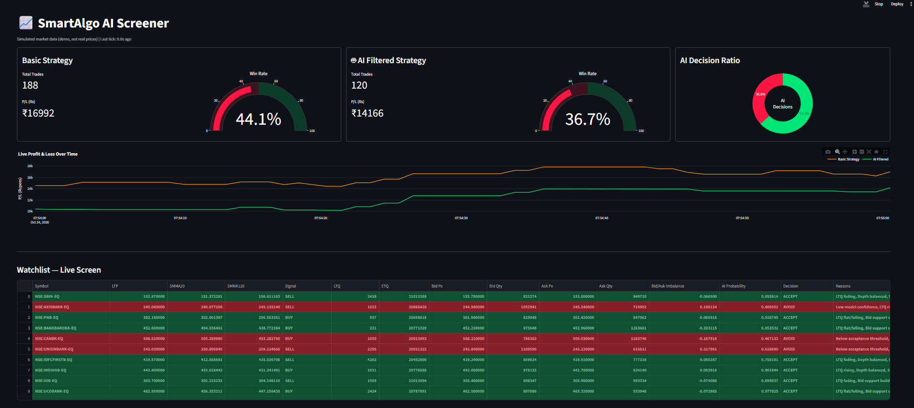
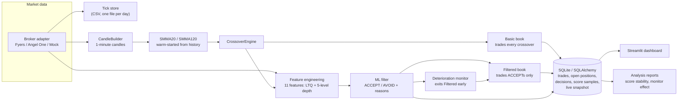

# AI/ML Real-Time Stock Screener (NSE)


**▶ Live demo: https://ai-stock-screener-demo-hwmhgdfx33svxcf78zrsjx.streamlit.app/**

A Python real-time screening and paper-trading system for NSE equities. It detects SMMA20/SMMA120 crossovers, reads Last Traded Quantity (LTQ) dynamics and 5-level Bid/Ask market depth, and passes each signal through a machine-learned **ACCEPT / AVOID** filter. The goal is to catch good trades and, more importantly, to avoid losing ones.



> **Paper trading only.** No real orders are ever placed. Nothing here is investment advice.

## Demo vs. real

The hosted demo runs the **same engine** as the live system (crossover detection, feature engineering, ML filter, paper-trading books) on a **synthetic price feed**, so it works instantly with no broker credentials.

- Prices in the demo are a random walk, so no model can have a real edge there. The demo shows the pipeline mechanics, not trading performance.
- The model was trained on 78 labelled crossovers from six early live Fyers files (some of which overlap, so some crossovers are probably counted twice). On a 16-example validation set it reached an AUC of 0.58, which is statistically indistinguishable from chance (p ≈ 0.33; 95% interval roughly 0.27 to 0.90). Treat it as a demonstration of the pipeline, not a trading edge. It will be retrained on cleaned, de-duplicated data as sessions accumulate.

## Architecture



The paper-trading engine is callback-based and does not depend on the database. A failing database write is logged and never stops the tick loop.

## How it works

1. **Ingest:** live ticks from Fyers (WebSocket + REST historical) or Angel One (SmartAPI), or a mock broker for the demo.
2. **Warm start:** SMMA20/SMMA120 are primed from historical candles, so signals are ready immediately instead of after about two hours of live data.
3. **Detect:** `CrossoverEngine` flags SMMA20/SMMA120 crossovers.
4. **Featurize:** 11 broker-agnostic features (SMMA, LTQ acceleration, 5-level bid/ask imbalance and more), so data from different days and brokers can be combined for training.
5. **Decide:** a `GradientBoostingClassifier` scores each crossover and returns ACCEPT or AVOID with a probability and human-readable reasons.
6. **Paper trade:** two books run side by side from the same feed.
    - **Basic:** enters every crossover.
    - **AI-Filtered:** enters only ACCEPTed signals and exits early when the position monitor flags deterioration.
7. **Persist:** closed trades, open positions, every decision (opened, avoided, skipped) and the live dashboard state are saved to a database, so history and open positions survive restarts.

Both books use stop-loss, target and max-hold exits. Each book holds at most one position per symbol.

## Quick start

### Docker (recommended)

You only need Docker. Run from the project folder.

**The demo** (synthetic data, no credentials):

```bash
docker compose --profile demo up --build
```

Open http://localhost:8501.

**The screener plus dashboard** (uses the mock broker by default):

```bash
docker compose --profile live up --build
```

Open http://localhost:8502. History is stored in a Docker volume that survives `docker compose down` (do not use `down -v` unless you want to wipe it).

### Without Docker

```bash
git clone https://github.com/Anishhgupta/ai-stock-screener-demo.git
cd ai-stock-screener-demo
pip install -r requirements.txt
streamlit run demo_app.py
```

To retrain the demo model: `python -m demo.train_demo_model`.

## Live mode (bring your own broker)

Each user runs their own instance with their own broker credentials. There is no shared data feed, which avoids redistributing broker data and regulated-advice territory.

1. Copy `.env.example` to `.env` and fill in your Fyers app credentials (never commit `.env`).
2. Fyers tokens expire daily: run `python fyers_login.py` each trading day and paste the printed token into `.env` as `FYERS_ACCESS_TOKEN`.
3. Real NSE depth rarely reaches the literal 10 lakh bid/ask quantity in the original spec, so set `SCREENER_MIN_DEPTH_QTY` (for example `2000`) before training or running. Otherwise every signal is silently screened out. On Windows CMD: `set SCREENER_MIN_DEPTH_QTY=2000`.
4. Train on saved ticks with `python -m ml.train --tick-csv <path>`.
5. Run the screener and the dashboard in two terminals:

```bash
python main.py --broker fyers
streamlit run dashboard/app.py
```

Pass `--no-db` to `main.py` to run without saving to the database.

A Windows `.exe` can be built with `build_exe.py` (PyInstaller).

## Saved history and crash-safe restarts

Paper trades and decisions go to a local SQLite database (`data/store/screener.db`; in Docker, a named volume). Set `SCREENER_DB_URL` to use another database such as Postgres. The dashboard shows live state plus all-time totals, the latest closed trades and the latest decisions, with reasons.

Tables: `users`, `paper_positions` (closed trades), `open_positions`, `trade_log`, `live_snapshots`, `crossover_events` and `score_samples`. Every row carries a `user_id`, so moving to multiple users later does not change the data model.

**Restart behaviour**

- An open position is saved when it opens and removed in the same transaction that records its close, so the saved set never disagrees with the trade history.
- On startup, positions saved earlier **the same IST day** are restored and keep running, along with the carried-forward decisions from the last dashboard snapshot.
- Positions left over from an **earlier day** are closed and labelled `Recovered after restart (marked at last snapshot price)`.
- A stop in the middle of the session leaves positions saved for the next start. Positions are only closed as `Session end` when the newest tick is at or after 15:30 IST.
- Ticks that arrive while the screener is down are not replayed, so a price gap shows up at the first live price after the restart.
- A saved row that cannot be restored is skipped and logged, and stays in the database.

**Score tracing.** The engine records every crossover with the features the model scored, then re-scores each setup every 5 seconds for up to 15 minutes. `python -m storage.analysis` compares the entry score with those later scores and reports how often a later score would have reversed the ACCEPT/AVOID verdict. In Docker: `docker compose --profile live run --rm dashboard python -m storage.analysis`.

**Monitor effect.** `python -m storage.monitor_effect --since YYYY-MM-DD` pairs each Filtered trade with its Basic twin and reports what the early exit changed, with an uncertainty range. In Docker: `docker compose --profile live run --rm dashboard python -m storage.monitor_effect --since 2026-10-15`.

**Tick-file audit.** `python check_ticks.py` is a read-only check that flags saved tick files that look wrong (weekends, rows outside market hours, implausible price ranges, and mock-feed depth patterns).

## Testing

```bash
pip install -r requirements.txt
pytest
```

174 automated tests run on every push through GitHub Actions. They cover the SMMA maths, candle aggregation, feature engineering, the depth screen, the crossover pipeline, the paper-trading engine, session-end handling, restart recovery, score tracing, the storage layer and the dashboard's data logic. Several are regression tests for real bugs listed below. The newer ones were checked by deliberately breaking the code to confirm the tests fail. A test guard also fails any test that writes into the real tick-data folder.

## What I found

This project is mostly a record of things that looked right and were not. The four findings that taught me the most:

**1. A "win rate" that was really a clock bug.** In the demo, every trade closed instantly at breakeven. Positions were stamped with wall-clock time, but exits were compared against an accelerated simulated clock, so every trade looked like it had been held past the max hold time. The fix was to use the triggering tick's timestamp everywhere, and it is now a rule: entry and exit logic only ever use the tick clock.

**2. The deterioration monitor was reacting to noise.** On the first live session, every ACCEPTed trade was closed in the same second it opened. The monitor re-scored the model on each tick, and the score swung by 19 to 86 points between consecutive ticks. My first theory (the LTQ flag) was wrong; the model-confidence flag was the one firing. The monitor now waits 120 seconds, requires the warning to persist for 30 seconds, and only exits when price is at or below entry. After the change, deterioration exits were held for 150 to 337 seconds. A paired comparison of the new monitor against Basic twins is **inconclusive**: 4 recent cuts, an average effect of −22 per trade with a range of about ±83. That is far too little data to say whether the monitor helps.

**3. My own training script was corrupting my data.** An audit of the saved tick files found duplicated sessions, mock rows mixed into real files and one file of 2.3 GB. The cause was that building a training set created the crossover engine with tick saving switched on, so every training run re-appended everything it read. Training and the end-to-end test no longer write there, and a regression test plus a guard in the test suite make a repeat fail loudly. The audit also confirmed that no mock rows reached the training set. Older files from before the fix are still mixed and are not used for training.

**4. The model is a proof of pipeline, not an edge.** The validation AUC of 0.58 means the model ranked 32 of 55 profitable/unprofitable pairs correctly. With 16 validation examples, one-sided p ≈ 0.33 and a 95% interval of roughly 0.27 to 0.90, that cannot be separated from guessing. Score tracing exists to test a further suspicion: that entry scores near 0.95 are not stable confidence. There is not yet enough data to say.

**5. Crash safety was a real gap.** A PC restart on 15 October lost the open positions and blanked every decision on the dashboard. Open positions and carried decisions are now persisted and restored as described above.

## Bugs found and fixed

Real debugging, documented rather than hidden:

- **Fyers message schema:** Fyers sends `SymbolUpdate` (LTP/LTQ/volume) and `DepthUpdate` (bid/ask levels, no LTP) as separate messages. The adapter now subscribes to both and merges them per symbol.
- **Falsy-zero breakeven bug:** `if p.pnl and p.pnl <= 0` silently dropped exact-breakeven trades (`0.0` is falsy in Python) from both win and loss counts. Now handled with explicit `is not None` checks and a separate breakeven bucket.
- **Mixed clocks in demo trading:** positions were stamped with wall-clock time but compared against an accelerated simulated clock, so every trade looked held for over the max hold time and closed instantly at breakeven. Entry now uses the triggering tick's timestamp.
- **Basic book never traded without a model:** trade logic was gated on model availability. Basic now always trades, with a placeholder AVOID decision when no model is loaded.
- **Blank decision display:** a crossover is a single-tick event, so decision columns were empty on over 99% of ticks. The last real value is now carried forward per symbol, in the demo and in the live dashboard (verified on a real Fyers session).
- **False "OPEN" log entries:** found on a live run. A crossover in a symbol that already had an open position was skipped correctly but logged as opened. Such entries are now logged as `SKIPPED` with the reason.
- **Noisy mock order book:** independently redrawn depth every tick made imbalance flip randomly and tripped the deterioration monitor. Mock depth is now autocorrelated like a real book.
- **Startup race on user creation:** the trading process and the dashboard could both create the default user at once. Caught by a multi-threaded test and fixed with insert-then-handle-conflict.
- **Model portability:** `joblib` models are not guaranteed to load across scikit-learn versions. Retrain locally or pin matching versions (the Docker image pins them).
- **Deterioration monitor closed trades within a second:** found on a live run. The monitor re-scored the model on every tick, and the score swung by 19 to 86 points between consecutive ticks, so all three ACCEPTed trades were closed in the same second they opened. The monitor now waits 120 seconds and only exits on a warning that persists for 30 seconds.
- **Open positions vanished at shutdown:** positions still open when a session ended were discarded and never recorded, leaving the history incomplete. They are now closed at the last price seen and labelled as session-end marks.
- **Training and tests polluted the real tick files:** building a training set (and one end-to-end test) created the crossover engine with tick saving on, so every run re-appended all the ticks it read to that day's tick file. Saved files grew to gigabytes with duplicated sessions and mock rows. Training and the test now never write there, and a test guard fails loudly if any test tries.
- **Open positions and decisions lost on crash or restart:** open positions are now saved and restored, and carried decisions are restored from the last snapshot. A mid-session stop no longer force-closes positions.

## Known limitations

- Positions closed by `Session end` or `Recovered after restart` are marks at the last known price, not real fills. Analyses should filter on those reasons.
- Restart recovery is covered by automated tests, but has not yet been exercised by killing the screener during a live market session.
- Ticks that arrive while the screener is down are not replayed.
- The Fyers access token must be regenerated every trading day.
- The model's training sample is tiny and partly duplicated, its validation AUC is indistinguishable from chance, and its score for the same setup can move by tens of points within seconds on real data. Its probabilities should not be read as confidence.
- Live paper-trading results so far cover a few sessions and a few dozen trades, far too few to judge the strategy. The comparison of the Filtered book against Basic is not statistically meaningful yet.
- Many Filtered trades have no Basic twin: after the monitor cuts a Filtered trade, a new crossover can re-enter Filtered while Basic still holds its original position.
- Some historical tick files from before the pollution fix contain duplicated sessions or mock rows. The model was not trained on mock rows.
- The Angel One adapter has not been exercised in a live session.
- The Docker setup keeps its own database, separate from a local run's.

## Tech stack

Python 3.12, scikit-learn, joblib, SQLAlchemy, SQLite, Streamlit, Plotly, pandas, fyers-apiv3, Angel One SmartAPI, Docker, pytest, GitHub Actions, PyInstaller.

## Roadmap

Done: CI and regression tests, database persistence, Docker, crash-safe restarts. Next: retrain on verified, de-duplicated data with a time-based split and a bootstrap confidence interval; an entry-filter report (ACCEPT vs AVOID outcomes) once enough scored crossovers exist; and refreshed live-dashboard screenshots. A multi-user FastAPI backend with per-user encrypted broker credentials is possible later, but is deprioritised because it means holding other people's broker credentials.